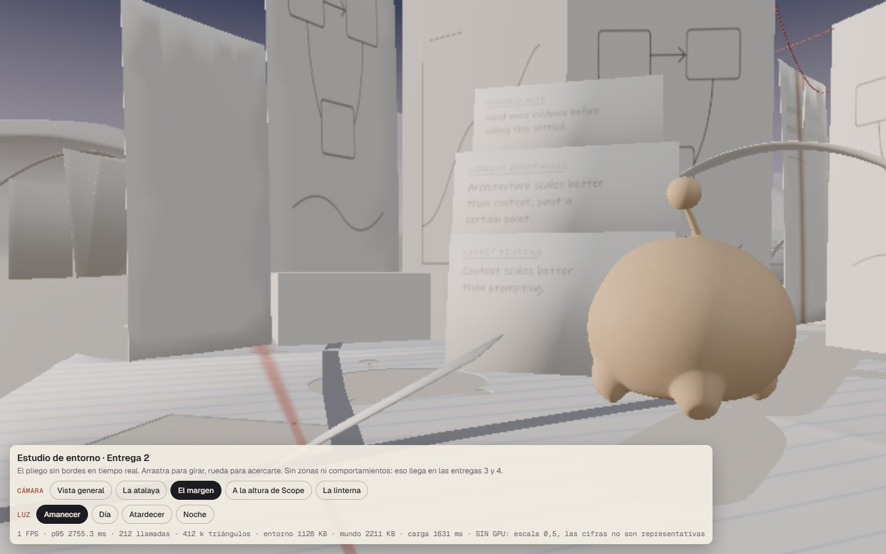
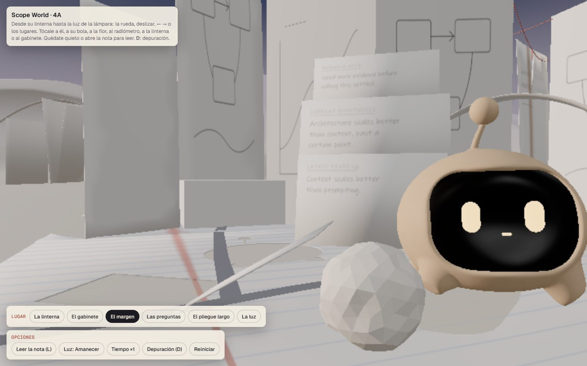
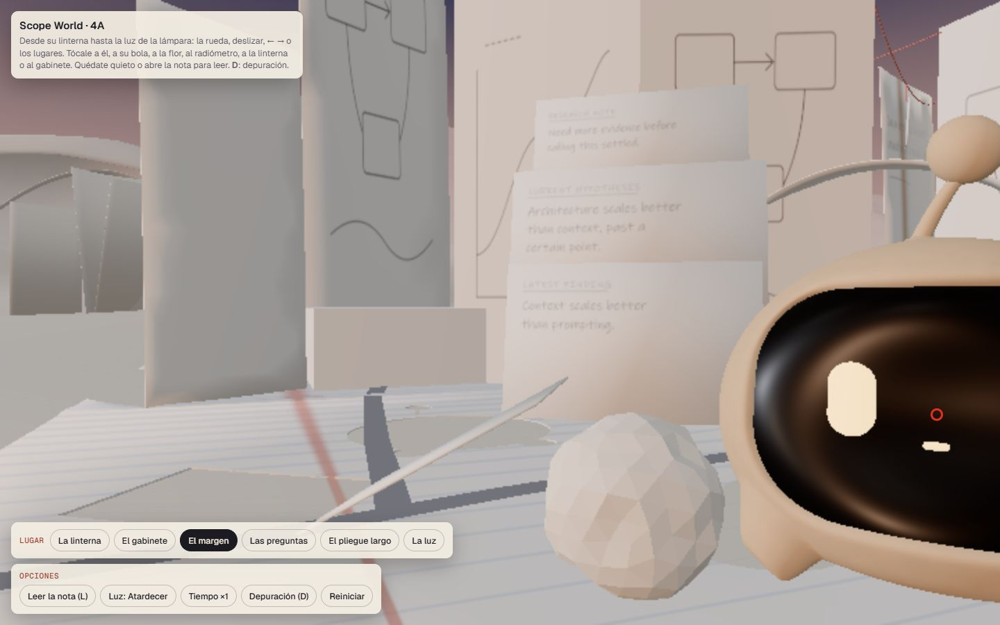
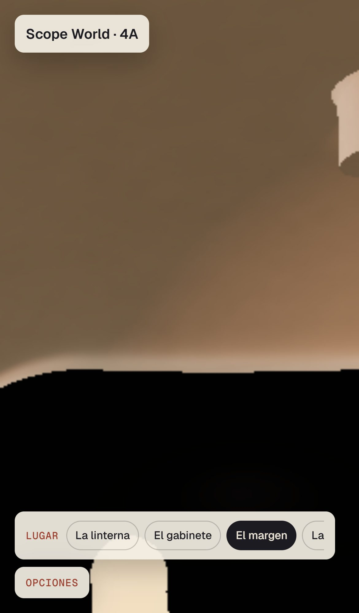
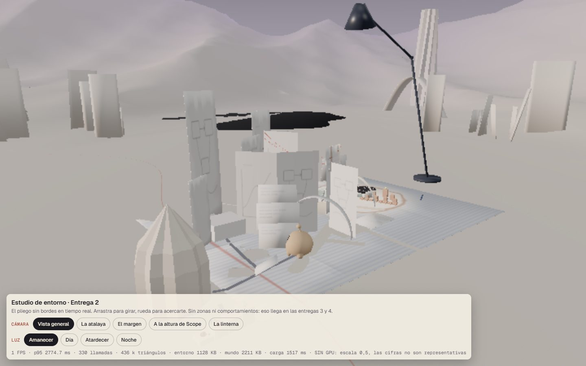
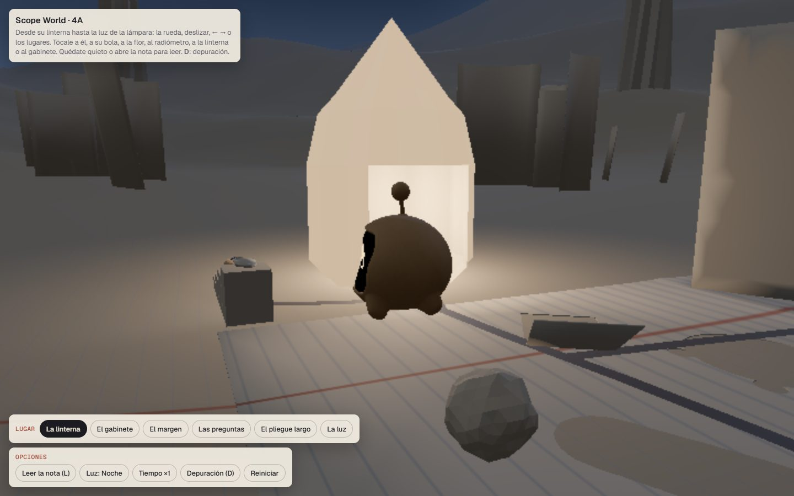

# Auditoría independiente · Scope World 2.0 · Entrega 4A

Fecha: 16 de octubre de 2026. Alcance: el estado del repositorio en `master` (`4467e0a entrega4`), sin cambios locales.
Evidencias: `auditoria-4a/capturas/` (40 capturas reales), `auditoria-4a/datos/` (resultados en bruto) y
`auditoria-4a/mapa-navegacion-4a.txt`.

> **Condiciones de medición, importantes para leer todo lo demás.** Este equipo **no tiene GPU**
> (adaptador de pantalla básico de Microsoft, i5‑13400, 15,8 GB). Todas las pruebas en navegador se han
> hecho con Chrome + SwiftShader (render por CPU, escala 0,5, **sin sombras**). Es la misma condición para
> el visor de la Entrega 2, el laboratorio de la Entrega 3 y 4A, así que las comparaciones entre ellos son
> justas; pero no dicen nada del aspecto ni del rendimiento con GPU. Las cifras con GTX 1660 Ti del
> README de 4A **no se han podido reproducir aquí**.

---

## A. Resumen ejecutivo

**¿Está terminada la Entrega 4A? PARCIALMENTE.**

La integración técnica es real y está bien hecha: hay un solo entorno (`core/env/stage.ts`) y un solo
Scope (`core/scope/`). El mundo de 4A es el de la Entrega 2, idéntico píxel a píxel con la misma cámara
(§F), y Scope camina sobre un suelo horneado de la geometría que se ve, reproducible byte a byte. Todo el
comportamiento de la Entrega 3 está presente porque es el mismo código, y casi todo funciona en sus
posiciones reales: refugio, bola, flor, radiómetro, memoria, prioridades, lectura y calma. No hay errores
de consola. No se ha empezado nada de 4B, 4C ni 4D. Producción, el GLB, el rig, los clips y MathView están
intactos.

Pero **los dos pilares no se conservan exactamente**:

1. **El Scope vivo pierde calidad justo en su casa.** En «El margen», la cámara aprobada (la de `home`)
   está a 10 cm del papel, y 4A ha colocado allí la bola y la acción de «acercártela». Por eso:
   - en el móvil, la cabeza de Scope llega a **5,8 cm del objetivo** y llena la pantalla (5 de 5 ejecuciones);
   - en escritorio se queda pegado a la cámara, cortado por el borde del encuadre;
   - en el laboratorio, Scope nunca baja de unos 65 cm.

   Además:
   - en los saltos largos está perdido **8,8 s**. El criterio aprobado en la Entrega 3 es de 6 s, y la
     prueba de 4A lo relajó a 9 s;
   - el trote resbala **2,5 veces más** que el aprobado, porque se subió su velocidad por encima del límite
     del paso.
2. **El mundo de papel conserva su geometría, pero no su intención de luz.** La Entrega 2 aprobó «intención
   lumínica por zona» (amanecer en el margen, día claro en el círculo, noche en la linterna). 4A usa una
   sola luz global (atardecer) con un botón atardecer/noche.

Además, la verificación que declara el README («22 de 22») **no se puede reproducir en este equipo**: se
cuelga por cómo está escrita la prueba, no por 4A. Y los 21 tests de comportamiento solo se ejecutan con la
definición del laboratorio, no con la de 4A.

**Recomendación: opción 2, corregir problemas concretos antes de aprobar** (§G). No hace falta rehacer la
integración.

---

## B. Matriz de cumplimiento

Leyenda: **CUMPLIDO** · **PARCIAL** · **NO CUMPLIDO** · **NO VERIFICADO**. «Navegador» quiere decir
ejecución real en Chrome. Las pruebas de comportamiento usan el reloj de simulación del propio
`window.__lab.advance` (determinista), y las de entrada, el ratón y el teclado reales.

### B.1 Estado del proyecto

| Requisito | Estado | Código | Prueba | Evidencia | Observaciones |
|---|---|---|---|---|---|
| Localizar 4A y las entregas 2, 3 y 4 | CUMPLIDO | `entrega-2-entorno/`, `entrega-3-comportamiento/`, `entrega-4-mundo/`, `core/` | `git log --stat`, árbol de ficheros | Un solo commit `4467e0a entrega4` (15‑10, 21:49) con 58 ficheros, todos bajo `docs/redesign/scope-world/` | El laboratorio de la Entrega 3 aparece por primera vez en git ya unificado sobre `core/` |
| `git status` limpio | CUMPLIDO | — | `git status` | Limpio al empezar; al terminar solo está la carpeta nueva de esta auditoría | — |
| Qué se reutiliza y qué se reconstruye | CUMPLIDO | `core/env/stage.ts`, `core/app/app.ts`, `core/scope/**` | Lectura completa y diff del visor contra `71c7151` | El montaje del visor (cielo, papel con *shader*, ambientes, fusión del relieve) se ha **movido** a `stage.ts`. El visor lo usa con sus parámetros de antes (sombra de 4 m, linterna de 2,5 m y su radiómetro). El laboratorio y 4A son **la misma app** (`core/app/app.ts`) con dos `WorldDef` | Arquitectura limpia. `core/` no ramifica por mundo; su única constante propia de un mundo es `stage.ts:240` (§D) |
| Producción intacta | CUMPLIDO | — | `git diff --name-only 71c7151 4467e0a` filtrando fuera `docs/redesign/scope-world/` | 0 ficheros fuera de Scope World | — |
| GLB, rig y clips intactos | CUMPLIDO | `public/scope/`, `assets/scope-3d/` | `git log` de esas rutas | El último cambio es `b680cc5`, anterior a 4A. Ningún fichero en `4467e0a` | `presence-hook.ts` envuelve en tiempo de ejecución una instancia del motor, sin tocar el fichero |
| MathView intacto | CUMPLIDO | `~/Documents/projects/MathView-*` | `git status` y fechas de los ficheros | Ningún fichero de `src/`, `docs/` ni `Backend/` posterior a la Entrega 2. Los cambios sin confirmar son del rediseño del 15‑10 (16:23), anterior a 4A | — |
| Se conservan los laboratorios aprobados | PARCIAL | `entrega-2-entorno/visor/src/main.ts` (−282 líneas), `entrega-3-comportamiento/lab/` | Diff y capturas comparadas | El visor se ve igual con la misma cámara (§F). **El código fuente del laboratorio anterior a la unificación no existe en git** (ni en objetos inalcanzables): la comparación «con el laboratorio original» solo puede hacerse con su forma actual | Los dos artefactos aprobados se modificaron en 4A. La equivalencia de comportamiento solo se puede comprobar indirectamente |
| Detenerse tras 4A | CUMPLIDO | — | Búsqueda de código de zonas y contenidos | Ningún código de 4B, 4C ni 4D: seis lugares, sin galería, aula ni contacto | El README dice «Sin commits», pero existe `4467e0a`, firmado con la identidad git del propietario. No puedo atribuir quién lo hizo |

### B.2 Entorno de la Entrega 2 en 4A

| Requisito | Estado | Código | Prueba | Evidencia | Observaciones |
|---|---|---|---|---|---|
| Paisaje continuo de papel, pliegues escultóricos, horizonte y profundidad | CUMPLIDO (en tiempo real) | `core/env/stage.ts:155-223` | Capturas de 4A, del laboratorio y del visor con la misma cámara y la misma luz | `4a-amanecer-lugar-2.jpg` frente a `visor-margen-amanecer.jpg`: entorno idéntico. Relieve, torres y lago en `4a-atardecer-lugar-0/3/4.jpg` | Ninguna cámara de 4A enseña el horizonte abierto («La atalaya», «Vista general»): solo se ve al fondo de los planos cercanos |
| Desaparece la plataforma rectangular flotante | PARCIAL (heredado) | `stage.ts:97-124` (*shader* del papel) | Las mismas capturas | En tiempo real, y sin sombras, el pliego pautado se lee como una losa de borde duro sobre el papel gris (`4a-atardecer-lugar-0.jpg`), y de noche aún más (`4a-noche-lugar-0.jpg`). **El visor aprobado se ve igual** (`visor-general-amanecer.jpg`) | No es una regresión de 4A: el borde solo desaparece en los renders de Cycles. Con GPU (sombras) no se ha podido comprobar |
| Líneas que se prolongan y disuelven; margen rojo | CUMPLIDO | `stage.ts:109-119` | Capturas | El margen bermellón y las pautas siguen fuera del pliego (`4a-atardecer-lugar-0.jpg`) | Mismo *shader* que el visor |
| **Iluminación ambiental por zonas** | **NO CUMPLIDO** | `core/app/app.ts:89-90, 302-306`; `stage.ts:33-38` | Lectura y capturas | Un único ambiente global: atardecer al cargar y un botón atardecer↔noche. Amanecer y día solo con `?hora=`. Ningún lugar cambia la luz | La Entrega 2 aprobó «amanecer en el margen, contraluz en la atalaya, día claro en el círculo, noche con la linterna» (su README, tabla «Qué cambia») |
| Refugio, gabinete y sus objetos | CUMPLIDO | `stage.ts:193-199` (lugares como mallas propias) | Capturas y prueba de refugio | `4a-*-lugar-0/1.jpg`. Scope entra en su plato (fases completas, §B.4) | — |
| Radiómetro | CUMPLIDO (reubicado) | `world-4a.ts:30`; `stage.ts:187` | Navegador y suelo horneado | El de la 2.0 se retira; un radiómetro interactivo en (0,27, −0,13), en el borde del círculo. Alcanzable a 13 cm desde 6 lados (§B.5) | El de la 2.0 sigue horneado como obstáculo invisible en (0,10, 0,30) (§D, Bajo) |
| Elementos interactivos aprobados | CUMPLIDO | `core/scope/props.ts` | Navegador | La bola, la flor y el radiómetro responden (§B.4) | La bola es un icosaedro facetado y muy visible bajo la cámara del margen (§D) |

### B.3 Comportamiento de la Entrega 3: acompañamiento y locomoción

Recorrido completo, adelante y atrás, muestreado cada 1/30 s, igual en 4A y en el laboratorio
(`datos/behaviour.json`):

| Requisito | Estado | Prueba | 4A | Laboratorio | Observaciones |
|---|---|---|---|---|---|
| Se mueve cuando avanzo | CUMPLIDO | Arranque por tramo | 0,13–0,73 s | 0,13–0,70 s | Igual |
| Puede adelantarse (guía) | CUMPLIDO | Estados «guiar» y «te espera allí» | En 4 de los 5 lugares nuevos («El pliegue largo» no ofrece nada) | En los 4 | — |
| Me espera | CUMPLIDO | Tiempo quieto con el visitante parado | Esperar o reposo en todos los tramos | Igual | — |
| Recupera la proximidad | PARCIAL | Salto casa → «La luz» y vuelta, 3 ejecuciones (`datos/jump.json`) | **8,8 s** perdido a la ida y 7 s a la vuelta | 4,7 s y 2,2 s | El criterio aprobado es de 6 s (`mind.test.ts`: «never lost for more than 6 s»). La prueba de 4A lo relajó a 9 s (`verify.mjs:160`) |
| Reconoce lugares visitados | CUMPLIDO | Estado «recordar» a la vuelta | 7,5 s | 9,7 s | — |
| No se pega a la cámara | **NO CUMPLIDO en «El margen»** | Distancia de la cabeza al objetivo, 5 ejecuciones × lugar × dispositivo (`datos/lens.json`) | Móvil en «El margen»: **5,8 cm**; 3,9 s a menos de 15 cm; ~12 s/min fuera de cuadro. Escritorio: 24,9 cm y 4 s fuera de cuadro. En el resto de lugares, ≥ 31 cm | En ningún lugar baja de 64 cm | Regresión nueva y reproducible (5 de 5). `movil-lugar-2.jpg` y `clic-real-scope-lugar-2-sin-panel.jpg` |
| Pasitos continuos, sin teletransportes | CUMPLIDO | Desplazamiento máximo por paso | 12,4 mm/(1/30 s) = su prisa | 9,1 mm | Coherente con cada velocidad |
| Sin deslizamiento apreciable | **PARCIAL** | Velocidad de las patas (huesos `foot*`) mientras apoyan (`datos/feet.json`) | Paseo 0,13 cm/s · **trote 3,9 cm/s** (cuerpo a 11,7) · prisa 13,2 cm/s (cuerpo a 23) | Paseo 0,15 · trote 1,6 (cuerpo a 10,2) · prisa 10,1 (cuerpo a 14) | El trote de 4A (14 cm/s) supera el límite sin deslizar del paso, 0,036/0,28 ≈ 12,9 cm/s (`gait.ts:215-218`). La prisa resbala en los dos al apoyar (`gait.ts:235`): ya ocurría en la Entrega 3 y en 4A es mayor |
| Paseo, trote y prisa; anticipación, frenada y giros | CUMPLIDO | Los modos aparecen en el recorrido; tests del locomotor | Paseo, trote, prisa y giro | Igual | 4 tests del locomotor en verde |
| Balanceo y antena | CUMPLIDO (por código) | `gait.ts:242-250`; muelle de producción | Lectura y capturas | Mismo código | No hay medida visual de la antena |
| Paso dentro del rango aprobado | CUMPLIDO | Lectura del panel | squash 0,948–1,012 y vuelo 7,0 mm | — | Dentro del Bounce aprobado (0,91–1,07 y 11 mm) |

### B.4 Interacciones y personalidad

| Requisito | Estado | Prueba (navegador) | 4A | Laboratorio | Observaciones |
|---|---|---|---|---|---|
| Se acomoda en su refugio | CUMPLIDO | Noche, quieto en casa | Empieza a los 60 s y está sentado a los 70,9 s, con las 6 fases; luz 0,35 | 30 s y 40,9 s | El tiempo cambia a propósito (README) |
| Sale del refugio | CUMPLIDO | Moverse estando dentro | Sale a 0,1 m del centro en 2,1 s (el acto `unfit` empieza en < 0,1 s) | Igual | — |
| Empuja la bola con la cara y la bola responde | CUMPLIDO | 90 s en «El margen» | 1 empujón; la bola llega a 0,27 m/s y avanza 8,3 cm | 2 empujones y 16,2 cm | Física real: velocidad de contacto |
| Activa la flor con su luz | CUMPLIDO | «Las preguntas» | Ilumina a los 1,8 s y se abre a los 6,8 s; alineación del haz 0,9995; a 12,8 cm | Se abre a los 10,1 s | — |
| Activa el radiómetro con su luz | CUMPLIDO | «La luz» | 23,6 rad/s; alineación 0,997; a 13,2 cm | 26,1 rad/s | — |
| Reacciona a clics (ratón real) | CUMPLIDO | Clic real en el punto proyectado en pantalla (`datos/input2.json`, `input3.json`) | Scope en los lugares 0, 2 y 5: «se gira hacia ti y reacciona». Bola: «va a empujarla hacia ti». Radiómetro: «va a iluminarlo». Linterna: «entra a descansar» | Igual | **La flor no se puede tocar**: un clic sobre ella cuenta como «señalas el suelo», en 4A y en el laboratorio (anterior a 4A) |
| Las interacciones no se cortan | CUMPLIDO | Clic y cambio de lugar durante el empujón | El empujón termina y luego reacciona | Igual | — |
| Rutinas, memoria y anti-repetición | CUMPLIDO | 10 min quieto | Descansa 525 de 600 s; una sola demostración | 555 s y 2 | — |
| Respeta la lectura | CUMPLIDO | 30 s con la nota abierta | Se mueve 0 mm; esperar y descansar | 6,7 mm | — |
| Sistema de prioridades | CUMPLIDO (por código y tests) | `mind.ts`, `types.ts:82-83` | Los grupos aparecen en el registro | — | Los 21 tests de la mente **solo usan `LAB_WORLD`** (`mind.test.ts:8`) |

### B.5 Integración real

| Requisito | Estado | Prueba | Evidencia | Observaciones |
|---|---|---|---|---|
| 1 · Mapa de navegación coherente con la geometría | CUMPLIDO | Volví a hornear con una copia del script fuera del repositorio | `floor.bin`, `nav.bin` y `solid.bin` **idénticos byte a byte**. `ground.json` es igual salvo las rutas. Mapa en `auditoria-4a/mapa-navegacion-4a.txt` | Generado de `world.glb` y `entorno.glb`, que es lo que se ve |
| 2 · Se desplaza por las superficies | CUMPLIDO | Caminos entre las 6 esperas | Las 15 parejas tienen camino; rodeo máximo ×1,46 | Altura continua: 1,67 mm por paso como máximo |
| 3 · No atraviesa objetos ni cae fuera | CUMPLIDO | Distancia del cuerpo (radio 6 cm) a los obstáculos reales sin ensanchar, en todo el recorrido | El peor solape es de **9 mm** (10 muestras de 6 030 por encima de 5 mm, al recortar una esquina). Nunca sale de la región transitable | La puerta de la linterna se recorre con un camino guionizado que ignora el mapa (`acts.ts:95-104, 242`): es intencionado |
| 4 · Radiómetro accesible | CUMPLIDO | Puntos libres a 13 cm | Ángulos 90°, 120°, 150°, 180°, 300° y 330°. Lo ilumina desde 13,2 cm | — |
| 5 · Escala y velocidad coherentes | PARCIAL | Gaits y saltos | Las marchas se aceleraron para recorrer distancias mayores (trote 13→14, prisa 22→30 cm/s) en vez de adaptar la ruta | Consecuencias: más deslizamiento (§B.3) y saltos de 9 s |
| 6 · Interacciones en sus posiciones reales | CUMPLIDO | Flor, bola, radiómetro y linterna en su sitio de `world-4a.ts` | Distancias y alineaciones medidas | — |
| 7 · Los juguetes reaccionan como en la Entrega 3 | CUMPLIDO | Mismas pruebas en los dos mundos | Diferencias de magnitud explicadas por la geometría | — |
| 8 · Arquitectura mantenible | CUMPLIDO | Lectura | `WorldDef` como datos, `Ground` como interfaz y una sola app | Buena base para 4B |
| 9 · Sin duplicación innecesaria | CUMPLIDO, con matices | Diff | `lab/index.html` y `mundo/index.html` se duplican casi enteros (CSS y HUD). Los dos `verify.mjs` también | Bajo |
| 10 · Sin coordenadas falsas ni atajos para las pruebas | CUMPLIDO | Búsqueda de literales y ramas por mundo en `core/` | Ninguna rama por id. `window.__lab` se expone siempre (incluye el actor) | Está declarado en el README de la Entrega 3 |

### B.6 Pruebas en navegador pedidas

| Prueba | Estado | Evidencia |
|---|---|---|
| Entrada inicial | CUMPLIDO | Sale de su linterna en < 0,6 s. Listo en 0,8–2,2 s (`datos/perf.json`, `visual.json`) |
| Recorrido completo | CUMPLIDO | `datos/behaviour.json` |
| Seguimiento, esperas y cambios de dirección | CUMPLIDO, salvo «El margen» | §B.3 |
| Clics sobre Scope | CUMPLIDO | Ratón real en 3 lugares |
| Cada juguete | CUMPLIDO, salvo la flor (no se puede tocar) | §B.4 |
| Refugio y radiómetro | CUMPLIDO | §B.4 |
| Navegación rápida | PARCIAL | Ráfaga de rueda: perdido ≤ 2,3 s. Salto largo: 8,8 s |
| Cambios de cámara | CUMPLIDO | Capturas de los 6 lugares de día y de noche |
| Recarga | CUMPLIDO | Vuelve al inicio (`now` 0, en su plato, lugar 0), sin errores |
| Teclado | CUMPLIDO para navegar; NO CUMPLIDO para interactuar | → ← Fin Inicio, Intro sobre un lugar y L/D funcionan, con foco visible. **Ningún control de teclado llega a Scope ni a sus juguetes** (0 elementos enfocables) |
| Movimiento reducido (preferencia real del sistema) | CUMPLIDO | `reducedMotion: "reduce"`: velocidad máxima 0, ningún clip, la cámara corta |
| Móvil (iPhone 13 emulado) | PARCIAL | La cinta táctil funciona y 5 de 6 lugares se ven bien. **En «El margen» Scope tapa la pantalla** (`movil-lugar-2.jpg`) |
| Consola | CUMPLIDO | 0 errores, 0 avisos y 0 respuestas 4xx/5xx en todas las sesiones |
| `verify.mjs` del proyecto | NO VERIFICADO aquí | Original: 7 de 22 y se cuelga. Con más tiempo de espera: igual. El del laboratorio: 4 de 20 y se cuelga. **No es un fallo de 4A**: `advance()` dibuja en cada paso y SwiftShader acumula miles de fotogramas antes de la captura. Con GPU probablemente pase |

### B.7 Calidad técnica

| Comprobación | Estado | Resultado |
|---|---|---|
| `core/tools/check.mjs` (TypeScript aislado, ESLint y `node --test`) | CUMPLIDO | TypeScript y ESLint en verde; **43 de 43** tests |
| `tsc --noEmit` de la raíz (incluye `docs/**/*.ts`) | CUMPLIDO | 0 errores |
| ESLint de la raíz con la configuración de producción (`docs/` incluido) | CUMPLIDO para 4A | 0 errores. 2 avisos previos en `src/components/theme/theme-transition-controller.tsx` y `.claude/skills/.../lint-copy.mjs`, que 4A no toca |
| Build de los paquetes | CUMPLIDO | Construidos de nuevo fuera del repositorio: `mundo.js` y `lab.js` son **idénticos** a los del repositorio (quitando CRLF). `visor.js` es antiguo: difiere en cómo se emiten los campos de clase y se comporta igual |
| `next build` | NO VERIFICADO | No lo ejecuté: reescribe `.next/`, la caché de trabajo del propietario. 4A no toca nada de lo que compila Next, salvo los `.ts` de `docs/`, que el `tsc` de la raíz ya ha comprobado |
| `docs/` no excluido | CUMPLIDO | `tsconfig` y `eslint.config.mjs` de la raíz sin tocar e incluyen `docs/` |
| Sin dependencias nuevas | CUMPLIDO | `package.json` sin cambios; esbuild es transitivo |
| Sin ficheros temporales ni procesos abandonados | CUMPLIDO | Ningún temporal en el repositorio. Ningún proceso ni puerto de 4A abierto al empezar |
| Cobertura de 4A en los tests unitarios | PARCIAL | Solo 5 tests usan `WORLD_4A` (suelo horneado). El comportamiento con sus bandas, tiempos y marchas no tiene test unitario |

### B.8 Alcance de la Entrega 4

| Hito | Esperado | Encontrado |
|---|---|---|
| 4A | Implementado, pendiente de validar | Implementado, con los problemas de §C y §D |
| 4B · Siete zonas | No iniciado | No iniciado (propuesto en el README §7, sin código) |
| 4C · Proyectos, cuaderno, docencia y contacto | No iniciado | No iniciado |
| 4D · Optimización y pulido | No iniciado | No iniciado |

---

## C. Regresiones (lo que en las entregas 2 y 3 funcionaba mejor)

1. **Scope invade la cámara en «El margen»** (de la Entrega 3). Ver §B.3. La causa está en `world-4a.ts`:
   - la bola empieza en (−0,66, −0,55), a unos 22 cm de la cámara `MARGIN_CAM`, que está a 10 cm de altura;
   - empujarla «hacia ti» lleva a Scope hacia el objetivo;
   - la banda «demasiado cerca» (0,20 m) se mide en el suelo y no sirve para una cámara tan baja.
2. **Saltos largos: 8,8 s perdido**, frente a 4,7 s en el laboratorio y al criterio aprobado de ≤ 6 s (de la
   Entrega 3).
3. **El trote resbala 2,5 veces más** (de la Entrega 3): 3,9 frente a 1,6 cm/s con la pata apoyada, por
   subir el trote a 14 cm/s. La prisa también resbala más (13,2 frente a 10,1 cm/s).
4. **Sin luz por zonas** (de la Entrega 2): el visor tenía cuatro ambientes y cada plano el suyo; 4A tiene
   un ambiente global y solo alterna dos.
5. **Más tiempo quieto mientras viajas**: 25 % frente al 9 % del laboratorio. Lo permite el diseño («si se
   le ve, se queda»), pero con tramos más largos se lee como menos compañía.
6. **Composición del lugar más emblemático.** En «El margen», el encuadre aprobado (`e2-home`) tenía a
   Scope entero a la derecha. En 4A la bola facetada ocupa el primer plano, y Scope acaba de espaldas o
   cortado (`4a-atardecer-lugar-2.jpg`, `clic-real-scope-lugar-2-sin-panel.jpg`).

Sin regresión, comprobado: el entorno con la misma cámara, refugio, flor, radiómetro, memoria, lectura,
calma, interrupciones, movimiento reducido, recarga, consola y carga.

## D. Problemas detectados

**Crítico:** ninguno.

**Alto**

- **H1 · Scope se mete en la cámara en «El margen»**, sobre todo en el móvil (5,8 cm, pantalla tapada). Es
  el lugar donde vive. `world-4a.ts:24, 42, 69-77` y la banda «demasiado cerca» de `companion.ts:10, 51`.
- **H2 · Falta la iluminación por zonas aprobada en la Entrega 2.** `app.ts:89-90, 302-306`.

**Medio**

- **M1 · Saltos largos de 8,8 s**, por encima del criterio aprobado de 6 s. La prueba de 4A relajó el
  umbral (`verify.mjs:159-160`) en lugar de señalarlo.
- **M2 · Más deslizamiento en trote y prisa** al acelerar las marchas (`world-4a.ts:119`; límite en
  `gait.ts:215-218`).
- **M3 · La verificación del README no se puede reproducir sin GPU.** El verificador de 4A se cuelga en la
  primera captura tras una simulación larga, y el del laboratorio igual. Los «22 de 22» y las cifras con
  GPU no son verificables en el equipo del propietario.
- **M4 · Ningún test unitario de comportamiento sobre `WORLD_4A`**: los 21 de la mente usan `LAB_WORLD`.
- **M5 · Se modificaron los artefactos aprobados** (el visor de la Entrega 2 refactorizado y el laboratorio
  de la Entrega 3 unificado), y el laboratorio original no queda en git. El resultado es equivalente según
  las pruebas, pero se pierde la referencia exacta de lo aprobado.
- **M6 · Sin acceso por teclado a Scope ni a sus juguetes** (no hay botones sobre los objetos; el prototipo
  1.0 los tenía). Ya ocurría en el laboratorio.

**Bajo**

- B1 · La flor no se puede tocar: el clic cuenta como suelo, en los dos mundos.
- B2 · El radiómetro 2.0 retirado sigue horneado como obstáculo invisible en (0,10, 0,30) (`bake-ground.mjs` no lo excluye).
- B3 · La posición de la luz de la linterna está fija en `stage.ts:240` en vez de leerse de `places.lantern`.
- B4 · `visor/dist/visor.js` no se reconstruyó tras añadir `scope-world/tsconfig.json`.
- B5 · `index.html` y `verify.mjs` están casi duplicados entre el laboratorio y el mundo.
- B6 · La bola es un icosaedro facetado y muy visible en primer plano (estética).
- B7 · El README de la Entrega 3 remite a un `config.ts` que no existe.
- B8 · El README de 4A dice «Sin commits», pero 4A está en el commit `4467e0a`.
- B9 · La simulación no es del todo determinista (dos ejecuciones del verificador dieron arranques de 0,77 y 0,03 s en el mismo tramo): las cifras de una sola ejecución son muestras.
- B10 · Sin GPU, 4A va a unos 7–10 FPS y no avisa de que el equipo no tiene GPU (el prototipo 1.0 sí avisaba).

## E. Rendimiento

**Condiciones:** este equipo, sin GPU; Chrome con SwiftShader (Vulkan por CPU); 1440 × 900 a escala 0,5;
sin sombras. Las tres páginas se midieron **una tras otra, sin otra carga**. Ventana de 60 fotogramas tras
6 s en cada lugar, con la cámara aún llegando. **No es representativo de un equipo con GPU.**

| Página | Lugar | FPS | p95 (ms) | Llamadas | Triángulos | Memoria JS (MB) |
|---|---|---|---|---|---|---|
| Visor E2 | general / atalaya / margen / escala / linterna | 1,9 / 21,2 / 7,5 / 4,6 / 8,8 | 1966 / 53 / 418 / 418 / 334 | 330 / 16 / 212 / 316 / 27 | 436 k / 190 k / 412 k / 431 k / 178 k | 19–31 |
| Laboratorio E3 | 0–4 | 7,1 · 9,6 · 8,8 · 8,2 · 8,6 | 280 · 125 · 136 · 141 · 137 | 34 · 53 · 83 · 117 · 166 | 180–211 k | 20–21 |
| **4A** | 0–5 | 7,8 · 9,7 · 7,7 · 6,7 · 7,1 · 7,2 | 205 · 121 · 177 · 177 · 153 · 151 | 34 · 53 · 101 · 164 · 158 · 133 | 180–212 k | 21–25 |

- **Carga:** página lista en 0,55–0,8 s con caché y 2,1–2,3 s en frío; datos del mundo en 184 ms. Mundo
  2,2 MB, entorno 1,1 MB y suelo horneado 0,5 MB.
- **Errores de WebGL:** ninguno en la consola.
- **Conclusión comparable:** con el mismo renderizador, 4A cuesta lo mismo que el laboratorio por lugar
  (±1 FPS) y bastante menos que las vistas amplias del visor.
- **Pendiente:** las cifras del README con GPU (176–180 FPS, p95 ~6 ms, GTX 1660 Ti) no son verificables
  aquí. Hay que medir con GPU, en un portátil con gráfica integrada y en un móvil real.

## F. Evidencias visuales

Todas las capturas están en `auditoria-4a/capturas/`, hechas con Chrome y SwiftShader, sin sombras:

- **4A:** `4a-atardecer-lugar-0…5`, `4a-noche-lugar-0…5`, `4a-amanecer-lugar-2` y `4a-luz-noche-boton`.
- **Laboratorio:** `lab-lugar-0…4`.
- **Visor E2:** `visor-general-amanecer`, `-horizonte-`, `-margen-amanecer/atardecer`, `-escala-` y `-linterna-noche`.
- **Clics reales** (círculo rojo = punto clicado): `clic-real-*`.
- **Móvil (iPhone 13 emulado):** `movil-lugar-0…5`.
- **Renders aprobados de referencia:** `entrega-2-entorno/renders/e2-*.jpg`.

**Misma cámara y misma luz:** el entorno se conserva.

| Visor de la Entrega 2 (aprobado) | 4A |
|---|---|
|  |  |

**El problema de «El margen»:** Scope pegado al objetivo (escritorio) y tapando la pantalla (móvil).

| Escritorio, tras 20 s | Móvil |
|---|---|
|  |  |

**El borde del pliego en tiempo real** (heredado: el visor aprobado se ve igual).

| Visor E2, vista general | 4A, la linterna de noche |
|---|---|
|  |  |

**Lugares que funcionan como se diseñaron:** `4a-atardecer-lugar-3.jpg` (la flor abierta, Scope de frente)
y `4a-atardecer-lugar-5.jpg` (el radiómetro en el círculo de la lámpara).

## G. Recomendación

**Opción 2: corregir problemas concretos antes de aprobar 4A.**

**Por qué no la opción 1.** El criterio final pide conservar *exactamente* lo aprobado. Hoy no se cumple
en el lugar más importante, la casa de Scope (H1), ni en la intención de luz de la Entrega 2 (H2).
Además, el comportamiento en saltos y el paso empeoran frente a lo aprobado (M1 y M2).

**Por qué no la opción 3.** La integración en sí es sólida:

- un solo entorno y un solo Scope;
- un suelo horneado reproducible y fiel a la geometría;
- todas las interacciones funcionan en sus posiciones reales;
- el entorno es idéntico al aprobado con la misma cámara;
- no hay errores;
- ninguna ampliación de alcance.

Todo lo pendiente se corrige con datos de `world-4a.ts` y pequeños ajustes, sin rehacer la arquitectura.

**Correcciones mínimas para validar 4A**, por orden:

1. **H1.** Sacar la bola y su empujón del eje de la cámara del margen, o impedir que Scope entre en un cono
   alrededor del objetivo. Volver a medir con 5 ejecuciones en escritorio y móvil: ningún lugar debería
   bajar de unos 30 cm.
2. **H2.** Asociar un ambiente a cada lugar, con transición, como en los planos de la Entrega 2. Mantener
   el botón como opción.
3. **M1 y M2.** Recuperar el criterio de ≤ 6 s en saltos largos sin pasar de la prisa aprobada (atajos o un
   salto de cámara más lento). Dejar el trote en ≤ 12,9 cm/s, o ajustar `SWING_MAX` y el periodo para que
   no resbale.
4. **M3 y M4.** Que `advance()` no dibuje en cada paso, para que las verificaciones funcionen también sin
   GPU. Añadir tests de la mente con `WORLD_4A` (perdido ≤ 6 s y distancia mínima a la cámara).
5. Después, que el propietario lo pruebe en su equipo con GPU y en un móvil real.

Los problemas Bajos y M5–M6 pueden quedar anotados para 4B y 4D.

---

### Nota sobre cómo se hizo esta auditoría

- **No se ha modificado** código de la aplicación, ningún laboratorio, producción ni MathView. No ha habido
  commits, push ni despliegues, ni se ha usado el puerto 3000.
- **Ficheros nuevos:** este informe y `auditoria-4a/` (capturas, datos y mapa).
- **Fuera del repositorio:** los scripts de auditoría, las rehorneadas y los paquetes de prueba están en la
  carpeta temporal de la sesión.
- **Efecto secundario:** el `tsc` de la raíz actualizó `tsconfig.tsbuildinfo`, una caché incremental
  ignorada por git.
- **Procesos:** usé servidores propios en los puertos 3111–3177 (salvo 3000, 3100, 3110, 3120 y 3130) y
  todos se cerraron. Una ejecución propia colgada se terminó, junto con sus hijos, por su PID. No se ha
  detenido ningún proceso ajeno.
